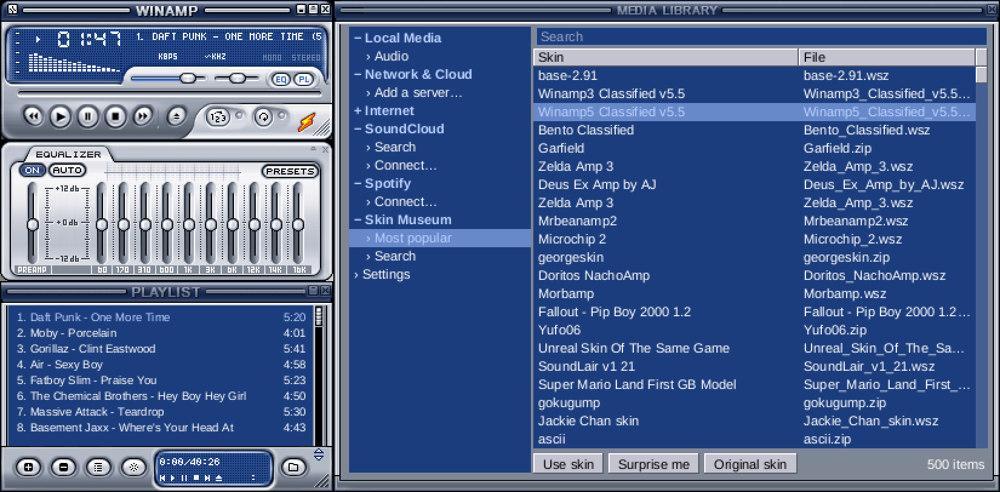
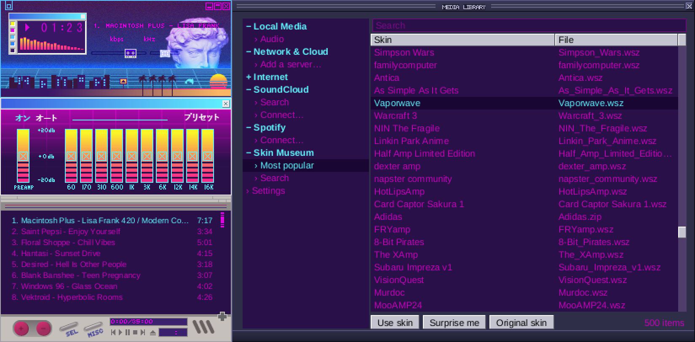

# Changelog

What changed in each Gamp release. Downloads are on the Releases page.

## 0.3.30 (2026-11-22)

- **Anonymous usage stats, your choice.** To see what to improve, Gamp can send a few anonymous facts when it starts: its version, your system and language. It never sends your music, files, accounts or addresses, and no IP addresses are kept. Gamp asks on first start, and nothing is sent until you answer.
- **Opt out any time:** right-click › Options › Share anonymous usage stats. Turning it off also erases what was sent.
- **Delete my data:** Options › Delete my data… erases the stats and everything Gamp keeps on your computer (settings, sign-ins, playlists, skins), then closes Gamp.
- **Help…** in the right-click menu opens the user guide in your language.

## 0.3.29 (2026-11-18)

Smoother playback.

- **No more skips on online music:** SoundCloud, radio, Plex, NAS and other network tracks are read well ahead, so a slow moment on the network isn't heard. A dropped connection picks up again without a gap.
- **Song changes:** the next network track connects before the current one ends.
- **Easier on speakers:** loud peaks are turned down smoothly instead of being cut off flat, and rumble too low to hear (under 25 Hz) is filtered out.
- **Window titles:** the default skin spaces its title letters so they read clearly.

## 0.3.28 (2026-11-17)

Gamp in four more languages: Dutch, Polish, Turkish and Korean.

- **Languages:** Nederlands, Polski, Türkçe and 한국어 join the eight Gamp already spoke. Gamp follows your system's language; Options › Language changes it.
- **Main display:** in Korean it stays in English, as in Japanese and Chinese, because skin fonts only have A to Z.

## 0.3.27 (2026-11-16)

The space bar plays and pauses.

- **Space bar:** pauses and resumes the track, or starts playing when the player is stopped. In the G-Drop window it still means next preset.
- **Donate:** a new entry in the main menu for anyone who wants to support Gamp. "Hide this" takes it out of the main menu; it stays under Options.

## 0.3.26 (2026-11-11)

Menus on Windows appear at once.

- **Windows menus:** they open instantly, in place. Windows used to play its window-opening animation on them, so they flew in.
- **Linux package:** names the window libraries Gamp loads, so a bare system installs them along with it.

## 0.3.25 (2026-11-11)

Menus on Linux, and a package for ARM.

- **Linux menus:** right-click and the menu button open their menus. In 0.3.24 and earlier they closed the moment they opened, so skins, options and Add to Favorites were out of reach.
- **Linux on ARM:** a new .deb for ARM computers (Raspberry Pi and others), next to the one for Intel and AMD.
- **Play after Stop:** the display shows the track playing right away. It used to wait until the mouse moved.
- **Small screens:** the library and G-Drop open fully on screen instead of running off the right edge.
- **Under the hood:** every package is now installed and run through Gamp's self-check before it goes into a release, and the libraries Gamp builds on are up to date.

## 0.3.24 (2026-10-29)

Favorites from the playlist, and menus that stay on screen.

- **Favorites from the playlist:** right-click a song in the playlist and choose Add to Favorites (or Remove). Works on a selection too, and on files from your own folders.
- **Menus stay on screen:** a menu near the bottom or right edge moves up or left so all of it shows. A list too long for the screen, like G-Drop's presets, goes on in More.
- **The playlist follows the music:** it scrolls to the track that's playing, when Gamp opens and whenever the track changes.

## 0.3.23 (2026-10-29)

Favorites, Audius, and a library that remembers your searches.

- **Favorites:** right-click anything in the library (a track, station, album, playlist or skin, from any source) and choose Add to Favorites. They're all together under Favorites at the top.
- **Recent searches:** open a source's Search and your last searches are listed. Double-click one to run it again.
- **Double-click:** plays just the track you clicked (or the ones you selected), not everything below it. Play all still plays the whole list.
- **Audius:** free, full-length music from independent artists, under Internet. Trending, Underground Trending and search (tracks, playlists, artists). No account needed.

## 0.3.22 (2026-10-29)

Your computer can sleep again while Gamp is open.

- **Sleep:** Gamp no longer keeps a Mac or Windows PC awake while nothing is playing. The sound output now rests a few seconds after playback stops or pauses, and wakes again when you press play.

## 0.3.21 (2026-10-28)

A nicer Mac install window.

- **Install window:** opening the Mac download now shows Gamp's own background, with an arrow from Gamp to the Applications folder.

## 0.3.20 (2026-10-27)

A fix for G-Drop in full screen.

- **G-Drop full screen stays put:** on Macs with Spaces, full-screen G-Drop could jump back and forth between screens. It now stays on the screen you put it on.

## 0.3.19 (2026-10-27)

A small follow-up to the eight-language release.

- **Letters from any script:** text the built-in font can't draw is now asked for once and drawn with a font the system already has, wherever Gamp runs.
- **Translations** for a few more of the player display's messages.

## 0.3.18 (2026-10-27)

Gamp speaks your language.

- **Eight languages:** English, Deutsch, Español, Français, Italiano, Português (Brasil), 日本語 and 简体中文. Gamp follows your computer's language; right-click › **Options › Language** picks another, and the menu item always says "(Language)" so you can find your way back.
- **Japanese, Chinese and Korean titles:** songs, artists and albums in those scripts now show in the playlist and Media Library, drawn with a font your system already has.
- The player's little display keeps the skin's own A-to-Z letters: accents are left off there, and in Japanese and Chinese its short messages stay in English.

## 0.3.17 (2026-10-26)

The Media Library shows it's working, and the Mac app opens with a double-click.

- **Busy, visibly:** the Media Library's Loading, Searching, Connecting and Scanning count their dots while they work, like the main display's CONNECTING, so a slow source plainly isn't stuck.
- **Signed and notarized by Apple:** on a Mac, open the `.dmg`, drag Gamp into Applications, and it opens with a double-click.

## 0.3.16 (2026-10-26)

Your recent searches, kept, and a display that shows it's working while a stream connects.

- **Recent searches:** the Media Library keeps your last five searches for each source (SoundCloud, Spotify, Internet Radio, Podcasts, the Skin Museum) right under its **Search**, newest first. Click one to run it again. They're still there after you quit.
- **Connecting, visibly:** while a SoundCloud track or radio stream opens, the display's `CONNECTING` dots count up, so you can see it's on its way and not stuck.
- **Signed and notarized by Apple:** on a Mac, open the `.dmg`, drag Gamp into Applications, and it opens with a double-click. No more Open Anyway.

## 0.3.15 (2026-10-24)

A crash fix for Macs, and a File Info window that shows everything.

- **Fixed: Gamp could quit when you saved a playlist on a Mac,** especially with a second screen. Dialogs (open, save, presets, skins, adding a music folder, the update question) now open just after the click that asks for them, so a window changing screens meanwhile can't take Gamp down.
- **If Gamp ever does crash,** it keeps the error message, and the next time you open it, right-click › **Report a problem…** sends that message along with your report.
- **File Info shows everything:** long titles, comments and web addresses wrap instead of being cut off, the window grows to fit, and **Copy** (or ⌘C) copies all of it as text.

Gamp isn't signed by Apple yet, so macOS asks you to confirm it once:

1. Open the `.dmg` and drag **Gamp** into **Applications**.
2. Open Gamp. When macOS says it can't check it (or "Apple could not verify…"), click **Done**, not Move to Trash.
3. Open **System Settings › Privacy & Security**, scroll down to **Security**, and click **Open Anyway** next to "Gamp was blocked to protect your Mac".
4. Click **Open Anyway** again and enter your password (or use Touch ID).

After that Gamp opens normally, and updates don't ask again. Or, in Terminal: `xattr -dr com.apple.quarantine /Applications/Gamp.app`

Still says "damaged"? That copy is an older download: move it to the Trash and download it again.

## 0.3.14 (2026-10-24)

Long mixes, done right: Gamp opens where you were, jumps anywhere in a SoundCloud mix in a second, and shows hours.

- **Gamp opens where you were, every time.** Quit, force quit, or even crash in the middle of a track, and the next launch shows it paused at that spot, time on the display, position bar in place. Press Play (or double-click it) and it carries on. Stop no longer forgets your place, and a stream that's slow to connect keeps it.
- **Far jumps in SoundCloud mixes take under a second**, not ten or more: Gamp opens the stream at the piece you're jumping to instead of reading through everything before it. Reopening a long mix is much faster too, and it no longer re-measures a mix's thousand pieces each time.
- **Hours in the time display.** Past an hour the digits read 1:23:45 (hours, minutes, seconds), in the main window, shade mode and the playlist. Dragging the position bar shows the time you're dragging to.
- **Play pauses when it's already playing** instead of starting the track over.
- **Report a problem…** in the right-click menu opens a report with the last error, your Gamp version and system already filled in; add what happened and send. There's a matching form on GitHub.
- **G-Drop** keeps the preset you chose: ⌘H (hide) and ⌘R no longer act as G-Drop's H (random preset) and R (cycle) keys.
- The time display and position bar no longer jump back to the old place while a far seek is on its way, and a jump that was in flight is forgotten when you change track.
- One-digit hours: a recording over ten hours shows its hour as 9 in the big display (the title shows the full time).

Gamp isn't signed by Apple yet, so macOS asks you to confirm it once:

1. Open the `.dmg` and drag **Gamp** into **Applications**.
2. Open Gamp. When macOS says it can't check it (or "Apple could not verify…"), click **Done**, not Move to Trash.
3. Open **System Settings › Privacy & Security**, scroll down to **Security**, and click **Open Anyway** next to "Gamp was blocked to protect your Mac".
4. Click **Open Anyway** again and enter your password (or use Touch ID).

After that Gamp opens normally, and updates don't ask again. Or, in Terminal: `xattr -dr com.apple.quarantine /Applications/Gamp.app`

Still says "damaged"? That copy is an older download: move it to the Trash and download it again.

## 0.3.13 (2026-10-23)

Windows that stay together, and music that picks up where you left off.

- **Gamp opens where you were.** Quit in the middle of a track (a three-hour SoundCloud mix, say), or even press Stop first, and Gamp opens on that track, paused at that spot, with the time showing. Press Play and it goes on from there. Your playlist comes back too, and Gamp saves every few seconds, so even a crash or a force quit loses only a moment.
- **Play pauses when it's already playing**, instead of starting the track over.
- **See where you're scrubbing to.** Dragging the position bar shows the time you're dragging to in the big display, not only in the title. Past 99 minutes, the display reads hours and minutes, so long mixes show the right time.
- **Docked windows stay docked across monitors.** Moving the player between a Retina screen and a bigger external one, plugging a monitor in, or changing the resolution no longer blows the windows apart. If the system pushes them around, they go back around the main window.
- **No more equalizer hiding behind the player.** Dragging the player to the top of a Mac's screen used to let macOS push it down onto the equalizer. Windows now snap to just under the menu bar and stop there together.
- **The equalizer's shade button no longer looks stuck down** when the window isn't the active one.

Gamp isn't signed by Apple yet, so macOS asks you to confirm it once:

1. Open the `.dmg` and drag **Gamp** into **Applications**.
2. Open Gamp. When macOS says it can't check it (or "Apple could not verify…"), click **Done**, not Move to Trash.
3. Open **System Settings › Privacy & Security**, scroll down to **Security**, and click **Open Anyway** next to "Gamp was blocked to protect your Mac".
4. Click **Open Anyway** again and enter your password (or use Touch ID).

After that Gamp opens normally, and updates don't ask again. Or, in Terminal: `xattr -dr com.apple.quarantine /Applications/Gamp.app`

Still says "damaged"? That copy is an older download: move it to the Trash and download it again.

## 0.3.12 (2026-10-22)

Gamp opens on a Mac again.

- **Fixed: "Gamp is damaged and can't be opened."** The Mac app in the downloads wasn't fully signed, so macOS refused it outright, with no way to open it. It's signed now: macOS asks you to confirm it once (below) and then opens it.
- Clearer install steps for Mac and Windows, here, in the README and on the website.

Gamp isn't signed by Apple yet, so macOS asks you to confirm it once:

1. Open the `.dmg` and drag **Gamp** into **Applications**.
2. Open Gamp. When macOS says it can't check it (or "Apple could not verify…"), click **Done**, not Move to Trash.
3. Open **System Settings › Privacy & Security**, scroll down to **Security**, and click **Open Anyway** next to "Gamp was blocked to protect your Mac".
4. Click **Open Anyway** again and enter your password (or use Touch ID).

After that Gamp opens normally, and updates don't ask again. Or, in Terminal: `xattr -dr com.apple.quarantine /Applications/Gamp.app`

Still says "damaged"? That copy is an older download: move it to the Trash and download it again.

## 0.3.11 (2026-10-22)

- **Skin Museum.** Skins › Skin Museum… (Alt+S) opens about 100,000 classic Winamp skins from the [Winamp Skin Museum](https://skins.webamp.org) right in the Media Library: the most popular, or search by name. Double-click one (or Use skin) and Gamp puts it on.
- **Surprise me** puts on a random favourite from the museum's top 2,000.
- **Keep this skin** adds a museum skin you like to your Skins menu for good; the ones you just try don't pile up.
- **Original skin (GAMP Classic)** is always one click away, in the Skins menu and on the museum page. The Skins menu now ticks the skin you're wearing.

Skins belong to their artists; Gamp downloads them from the museum when you pick them. Ones the museum flags as not safe for work stay out.

Gamp isn't signed by Apple yet, so macOS asks you to confirm it once:

1. Open the `.dmg` and drag **Gamp** into **Applications**.
2. Open Gamp. When macOS says it can't check it (or "Apple could not verify…"), click **Done**, not Move to Trash.
3. Open **System Settings › Privacy & Security**, scroll down to **Security**, and click **Open Anyway** next to "Gamp was blocked to protect your Mac".
4. Click **Open Anyway** again and enter your password (or use Touch ID).

After that Gamp opens normally, and updates don't ask again. Or, in Terminal: `xattr -dr com.apple.quarantine /Applications/Gamp.app`

## 0.3.10 (2026-10-22)

- **Gather windows.** Right-click › Gather windows (Alt+W) brings every open window back together: the main window fully on screen, the equalizer and playlist stacked under it, the Media Library and G-Drop beside them. On a Mac, clicking Gamp in the Dock does it too when a window has ended up off-screen (an unplugged display, say).
- **Much less CPU.** G-Drop no longer animates while nothing is playing (it holds its last frame, as Winamp's visualizers did): open and idle went from about 35% CPU to almost nothing. The Media Library no longer redraws 30 times a second while music plays (25% → 4%). Windows fully covered or on another desktop stop drawing, G-Drop's picture takes about half the work, and the other windows stay at 30 frames a second while it runs.

Gamp 0.3.9 offers this update by itself; older versions install it by hand.

## 0.3.9 (2026-10-21)

- **Gamp asks when a new version is out.** A dialog shows what's new, with **Update now** and **Later**. Update now downloads it, closes Gamp, swaps in the new version and opens it again. Later keeps "Update to Gamp …" in the right-click menu.
- **`gamp --update`** updates from a terminal.

If you have 0.3.8 or older, install this one by hand once (or right-click › Update to Gamp 0.3.9…). From here on, Gamp asks.

## 0.3.8 (2026-10-21)

- **See when tracks were posted, and how popular they are.** SoundCloud lists now have Posted, Plays and Likes columns. Click any header to sort; dates and counts start with the newest or biggest, and a second click reverses.
- **Latest from an artist.** Right-click a SoundCloud track and choose **Latest from …** to list all of that artist's uploads, newest first. Pasting an artist's link into Search does the same. Tracks SoundCloud only plays on its own site show dimmed.

- **Gamp opens the way you left it.** Windows you'd closed (G-Drop, the Media Library…) stay closed instead of popping up at launch. Reopen any of them from the main menu (right-click the player) or with Alt+E / G / K / L.

## 0.3.7 (2026-10-20)

- **Songs keep playing through a dropped connection.** If the Wi-Fi blips or a stream's link expires mid-song, Gamp reconnects and carries on from the same spot instead of ending the song. This covers every network source.
- **SEEKING... on the player** when a jump takes a moment (far into a long SoundCloud mix).
- **SoundCloud previews are labelled.** Tracks SoundCloud only lets you hear for 30 seconds show as "(preview)" in the playlist, with their real 0:30 length.

## 0.3.6 (2026-10-20)

- **Long tracks start in seconds.** SoundCloud's AAC streams (most tracks now, and every long mix) used to take up to a minute to begin; a 2-hour mix now starts in about 3 seconds.
- **CONNECTING... on the player** while a SoundCloud or other network track loads.
- **Search leaves out tracks SoundCloud only plays on its own site** (copy-protected label releases), so what you find plays.
- **When a track can't play, the player says why** instead of silently skipping.

## 0.3.5 (2026-10-19)

Right-click › Options › Sleep timer: the music stops after 15, 30, 45, 60 or 90 minutes, fading out over the last 30 seconds. The menu shows the minutes left; Off cancels it.

- **Ctrl+V** (⌘V on a Mac), or Options › Stop after current track: the song playing finishes, then Gamp stops.
- **Shift+V** fades out over 3 seconds and stops.

At sizes like 110%, 130% or 150% (⌘+ / Ctrl+), pixels and letters are now even: before, some columns were drawn twice and letter strokes came out uneven. 100%, 200% and 300% stay perfectly sharp.

- **Mac (Apple silicon, M1 and later):** `Gamp-v0.3.5-macOS-apple-silicon.dmg`
- **Mac (Intel):** `Gamp-v0.3.5-macOS-intel.dmg`
- **Windows:** `Gamp-v0.3.5-Windows-setup.exe`
- **Linux:** `Gamp-v0.3.5-Linux-amd64.deb` or `Gamp-v0.3.5-Linux-x86_64.AppImage`

## 0.3.4 (2026-10-19)

Make every window bigger or smaller like zooming a web page: **⌘+**, **⌘−** and **⌘0** on a Mac, **Ctrl+**, **Ctrl−** and **Ctrl+0** on Windows and Linux. Each press is 10%, from 100% up to 300%. Right-click › Options › Size lists the sizes too. The player, equalizer, playlist, Media Library, G-Drop and menus all grow together, stay docked, and Gamp remembers the size.

- Gamp keeps your playlist when it quits, however you quit it (⌘Q, the Dock, shutting down). Before, the last changes could be lost.
- **LIST › Save list** saves the playlist by name. **LIST › Load list** shows your saved playlists, or opens any `.m3u8`, `.m3u` or `.pls` file. Spotify, SoundCloud, radio and NAS songs all come back.
- In the Media Library, right-click a song (or press Shift+Enter) to **Add to playlist** without stopping what's playing.

- Clicking the picture no longer switches visuals; drag it to move the window.
- Resize from any edge or corner.
- A full-screen button next to close. Esc or a double-click leaves full screen.
- Right-click for every preset, next, previous and random, and **Cycle presets**: on, it changes by itself; off, it stays on the one you picked. Gamp remembers your choice.

Every window's title bar is now the same height as the player's.

- **Mac (Apple silicon, M1 and later):** `Gamp-v0.3.4-macOS-apple-silicon.dmg`
- **Mac (Intel):** `Gamp-v0.3.4-macOS-intel.dmg`
- **Windows:** `Gamp-v0.3.4-Windows-setup.exe`
- **Linux:** `Gamp-v0.3.4-Linux-amd64.deb` or `Gamp-v0.3.4-Linux-x86_64.AppImage`

## 0.3.3 (2026-10-19)

Loud and quiet songs now play at about the same volume. Files with ReplayGain tags (MP3, FLAC, M4A, Ogg and more, from any source: folders, NAS, Plex and the rest) are leveled by them, never pushed past their peak. Spotify uses its own leveling, like the Spotify app's "Normal" setting.

- **Save…** keeps your own presets; they show under Load.
- **From file…** opens Winamp `.eqf` presets and `.q1` preset libraries. You can also drop one on Gamp or double-click it in the Finder.
- The built-in presets now match Winamp's own. Before, several were off (Full Bass cut its lowest band) and all were about 1.6 times too strong.

If their desktop app is on your computer, Gamp finds the folder by itself and lists it under Network & Cloud. Online-only songs download when you play them.

- **Mac:** songs, playlists, skins and presets open from the Finder (double-click, Open With › Gamp). Before, nothing happened.
- AIFF files show up in folder listings.

- **Mac (Apple silicon, M1 and later):** `Gamp-v0.3.3-macOS-apple-silicon.dmg`
- **Mac (Intel):** `Gamp-v0.3.3-macOS-intel.dmg`
- **Windows:** `Gamp-v0.3.3-Windows-setup.exe`
- **Linux:** `Gamp-v0.3.3-Linux-amd64.deb` or `Gamp-v0.3.3-Linux-x86_64.AppImage`

## 0.3.2 (2026-10-19)

Liked Songs, playlists and search now show every song. Big libraries were cut short before (one test library of 8,035 liked songs showed only 316), because Spotify turned away the song-by-song lookups. Gamp now asks for songs in batches, the way Spotify's own apps do, and remembers them, so reopening a list is instant. If Spotify still holds songs back, Gamp says so instead of showing a list with gaps.

- **Windows:** opening, closing or rolling up the equalizer or playlist only moves windows docked to it, never a window parked elsewhere.
- **Synology:** QuickConnect addresses copied from the browser (like `mynas.de3.quickconnect.to`) work. A wrong password is reported straight away, and Gamp finds the NAS faster after you move between home and away.
- **SoundCloud:** your Likes and Playlists open without looking up your profile every time.
- **Display:** messages start scrolling from their first letter, and the song title picks up where it left off.
- **Updates:** turning off update checks also turns off the 6-hourly check.
- Leftover sign-in tokens from older versions are cleaned up.

- **Mac (Apple silicon, M1 and later):** `Gamp-v0.3.2-macOS-apple-silicon.dmg`
- **Mac (Intel):** `Gamp-v0.3.2-macOS-intel.dmg`
- **Windows:** `Gamp-v0.3.2-Windows-setup.exe`
- **Linux:** `Gamp-v0.3.2-Linux-amd64.deb` or `Gamp-v0.3.2-Linux-x86_64.AppImage`

## 0.3.1 (2026-10-18)

G-Drop now has **40 presets** (15 new): Kaleidoscope, Classic Analyzer, Sunburst, Rorschach, Lava Lamp, Hyperspace, Snowflake, Disco Floor, Tidal Sun, Electric Sheep, Retro TV, Ink Drop, Mandala, Bass Cannon and Tron Horizon. New effects behind them: mirror and kaleidoscope symmetry, Winamp-style spectrum bars, and a spectrum sunburst. Open G-Drop with Alt+K; click for the next preset, H for a random one, F for full screen.

- Gamp checks for a new version when it starts and every 6 hours while it's open.
- If an update can't install by itself (the download fails, or Gamp runs from the disk image or another place it can't replace itself), Gamp opens this download page so you can install it by hand.
- On a Mac, a failed update now always leaves your current Gamp working and reopens it.

- Media Library and G-Drop dock on the left when there's no room on the right.
- Long messages scroll in the player's display instead of being cut off.
- Your network's DLNA servers show up without clicking Search again.

- **Mac (Apple silicon, M1 and later):** `Gamp-v0.3.1-macOS-apple-silicon.dmg`
- **Mac (Intel):** `Gamp-v0.3.1-macOS-intel.dmg`
- **Windows:** `Gamp-v0.3.1-Windows-setup.exe`
- **Linux:** `Gamp-v0.3.1-Linux-amd64.deb` or `Gamp-v0.3.1-Linux-x86_64.AppImage`

The builds are unsigned: on a Mac, right-click › Open the first time; on Windows, More info › Run anyway. Gamp 0.3.0 offers this update by itself (right-click › Update to Gamp 0.3.1…).

## 0.3.0 (2026-10-17)

Connecting your music is now one click or one box, with no developer accounts or API keys.

- **Spotify (Premium):** click Connect and sign in. Liked Songs, playlists and search all work; you no longer need your own Spotify developer app.
- **SoundCloud:** search works without an account. To see your likes and playlists, paste your profile link (they need to be public). Pasted track, playlist and artist links still play.
- **Synology Audio Station:** type your QuickConnect ID, or just the NAS's name or IP. Gamp finds it at home and away by itself and fills in the DSM port.
- **Dropbox:** still needs an app key for now (one-click Connect is coming).

- Spotify songs play again (they were silent).
- Windows dock when you open them: the equalizer slots in under the player, the playlist goes at the bottom of the stack, and the Media Library and G-Drop dock to the right. Closing the equalizer pulls the playlist up so the stack stays together.
- DLNA servers on your network (Synology Media Server, Plex) show in the Media Library without having to click Search again.
- Errors in Settings (a wrong password, an unknown profile) now show in the player's display instead of nowhere.

- **Mac (Apple silicon, M1 and later):** `Gamp-v0.3.0-macOS-apple-silicon.dmg`
- **Mac (Intel):** `Gamp-v0.3.0-macOS-intel.dmg`
- **Windows:** `Gamp-v0.3.0-Windows-setup.exe`
- **Linux:** `Gamp-v0.3.0-Linux-amd64.deb` or `Gamp-v0.3.0-Linux-x86_64.AppImage`

The builds are unsigned: on a Mac, right-click › Open the first time; on Windows, More info › Run anyway. Gamp 0.2.0 updates itself (right-click › Check for updates…).

## 0.2.0 (2026-10-16)

G-Amp is now a fully native app, rebuilt from scratch in Rust: its own skin engine, audio engine and visualizers. No web view.

**New**
- Every Winamp window as its own small native window: player, equalizer, playlist, Media Library and the G-Drop visualizer (25 presets). Windows dock and snap; classic `.wsz` skins load as they are.
- Our own audio engine: 10-band EQ, gapless playback, sample-accurate seeking.
- SoundCloud: paste any track, playlist or artist link into Search to play it, no account needed.
- Spotify: Liked Songs, playlists and search use your own free Spotify app's Client ID (steps in Settings › Spotify). Search also finds your playlists.
- Updates itself: right-click › Check for updates…
- Media keys and Now Playing on macOS, Windows and Linux.

**Downloads**
- macOS: `macOS-apple-silicon.dmg` (M1 and later) or `macOS-intel.dmg`. Unsigned: right-click › Open the first time.
- Windows: `Windows-setup.exe`. Unsigned: More info › Run anyway.
- Linux: `.deb` (Ubuntu, Debian) or `.AppImage`.

