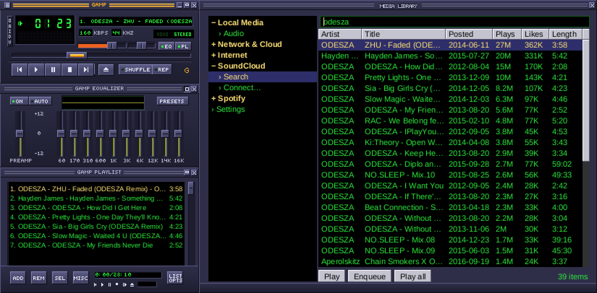
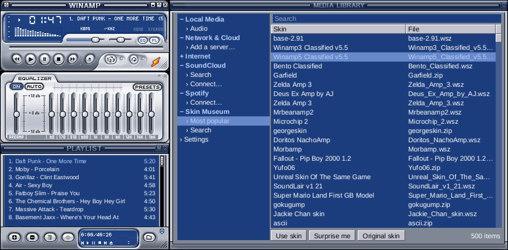
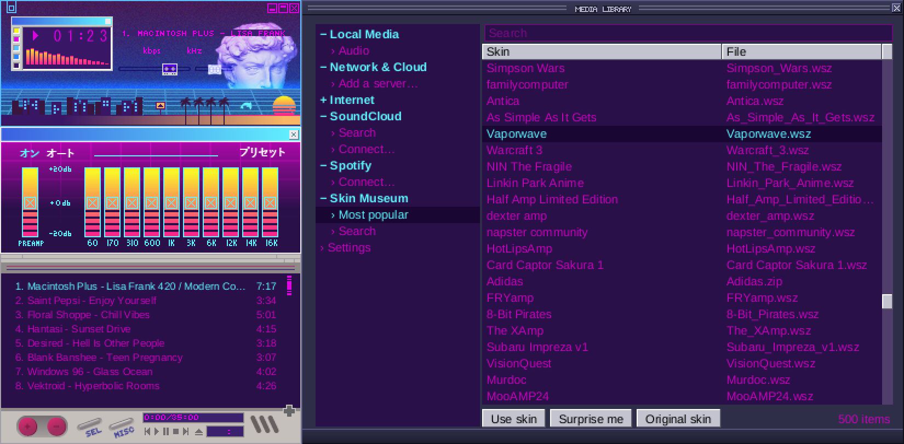

<p align="center"></p>

# Gamp

The classic Winamp 2 player, rebuilt from scratch as a native app for
macOS and Windows (Linux builds too). It plays everything you have: music
folders and network drives, your NAS and media servers, Dropbox, Google Drive and OneDrive, internet
radio, podcasts, the Internet Archive, SoundCloud and Spotify. The
equalizer, skins and the G-Drop visualizer work on every source.

<p align="center"></p>

<p align="center"> </p>
<p align="center"><em>Winamp5 Classified and Vaporwave: two of about 100,000 classic skins in the built-in Skin Museum.</em></p>

Every window is its own small borderless window drawn pixel for pixel from
the skin, like the original: player, equalizer, playlist, Media Library and
G-Drop. Classic `.wsz` skins load as they are. Idle, it uses next to no CPU.

## Sources

| Source | What you need |
|---|---|
| **Folders and network drives** | Any folder this computer can open: a mounted SMB/AFP/NFS share (macOS `/Volumes`, Windows `\\server\share` or a drive letter, Linux `/mnt`). Settings can connect to `smb://` shares for you. |
| **Plex** | Sign in with Plex. Every server on your account is added, with its home and away addresses. |
| **Jellyfin / Emby** | Server address, user name and password. |
| **Navidrome, Airsonic, Gonic, Ampache, LMS** (any Subsonic API server) | Server address, user name and password. |
| **Synology Audio Station** | Your QuickConnect ID (or the DSM address, `http://nas:5000`), user, password, and two-step code if you use one. With QuickConnect, Gamp finds the NAS at home and away by itself. |
| **WebDAV** (Synology WebDAV Server, Nextcloud, ownCloud, pCloud, QNAP...) | Folder address, user name and password. |
| **DLNA / UPnP** (Synology Media Server, minidlna, routers, Windows Media sharing) | Nothing. Servers on your network appear by themselves. |
| **Dropbox, Google Drive, OneDrive** | Their desktop app, signed in. Gamp finds the folder by itself and plays from it; songs download as you play them. |
| **Internet radio** | Nothing. About 50,000 stations from the [radio-browser.info](https://www.radio-browser.info) directory. Paste any stream, `.pls` or `.m3u` address to play it. |
| **Podcasts** | Nothing. Search Apple's directory or paste any RSS feed, then subscribe. |
| **Internet Archive** | Nothing. The Live Music Archive, 78 RPM records, netlabels, old-time radio, and search. |
| **Spotify** | A Premium account. Click Connect and sign in: Liked Songs, playlists and search show up. |
| **SoundCloud** | Nothing. Search, or paste any track, playlist or artist link. For your likes and playlists, add your profile's address (they need to be public). Tracks show when they were posted, plays and likes; click a header to sort, and right-click a track for **Latest from** its artist. |

Every server address works at home or over the internet, so a NAS can be
played from anywhere it can be reached. Self-signed certificates (common on
NAS boxes) can be accepted per server.

Not supported: Mixcloud (its API doesn't allow playback in other apps),
YouTube, Apple Music, Tidal and Deezer (no public playback APIs), Google
Drive and OneDrive without their desktop apps.

## Download

Builds for macOS (Apple silicon and Intel), Windows and Linux are on the
[Releases](https://github.com/fillinthe/g-amp/releases) page. The Mac app is
signed and notarized by Apple: open the `.dmg`, drag **Gamp** into
**Applications**, and it opens with a double-click. On Windows, if SmartScreen
appears, choose More info › Run anyway. Gamp checks for new versions when it opens and every few hours,
asks whether to update (with what's new), then updates itself and opens again.
Right-click › Check for updates… asks now; `gamp --update` updates from a terminal.

Mac copies older than 0.3.16 aren't signed: if macOS won't open one, download
Gamp again, or click **Open Anyway** in System Settings › Privacy & Security.

## How it works

Everything is our own code: the skin engine, the pixel renderer, the audio
engine (decode, resample, 10-band EQ, gapless) and the visualizers. Inside,
a small server on `127.0.0.1:8742` turns every source into one plain,
seekable audio stream:

- media servers, WebDAV, Dropbox, DLNA, podcasts and the Archive are proxied
  with byte ranges;
- radio streams are passed through, including old SHOUTcast servers, and
  the station's song titles show in the scrolling display;
- SoundCloud's HLS (MP3 or AAC) is stitched into one seekable file;
- Spotify is decoded by librespot into a seekable stream.

The server only listens on 127.0.0.1, refuses requests from other web
origins, and only fetches track addresses it signed itself. Passwords and
tokens stay in the app's data folder, readable by your user alone.

## Build

Needs Rust 1.90+. On Linux, the ALSA, X11/Wayland and xkbcommon headers.

- `crates/gamp-core`: every music source, the library, Spotify, SoundCloud, the settings store and the local server.
- `crates/gamp-audio`: the audio engine.
- `crates/gamp-skin`, `crates/gamp-ui`: Winamp skins and the windows.
- `crates/gamp-vis`: G-Drop and the spectrum.
- `apps/gamp`: the app.
- `tools/skin-gen`: draws the default skin, GAMP Classic.

```sh
cargo run --release -p gamp     # run it
cargo test --workspace          # tests
target/debug/gamp --selftest    # the app, headless: plays, scans, seeks, draws
cargo packager --release -p gamp  # dmg / setup.exe / deb / AppImage (cargo install cargo-packager)
```

## Credits

The skin sprite map comes from [Webamp](https://github.com/captbaritone/webamp)
(MIT). Spotify playback uses [librespot](https://github.com/librespot-org/librespot)
(MIT), the open-source engine also used by spotifyd and ncspot. Spotify
does not officially support third-party players, so use it at your own risk.

Winamp is a trademark of its owner. This project is not affiliated with or
endorsed by Winamp, Spotify, SoundCloud, Plex, Synology, Dropbox or any
other service it connects to.

## License

MIT. See [LICENSE](LICENSE).
